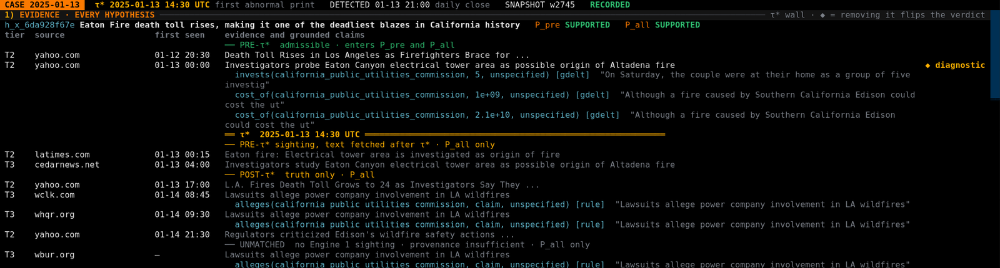
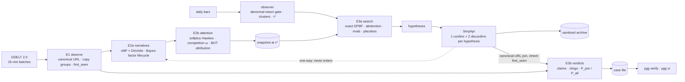
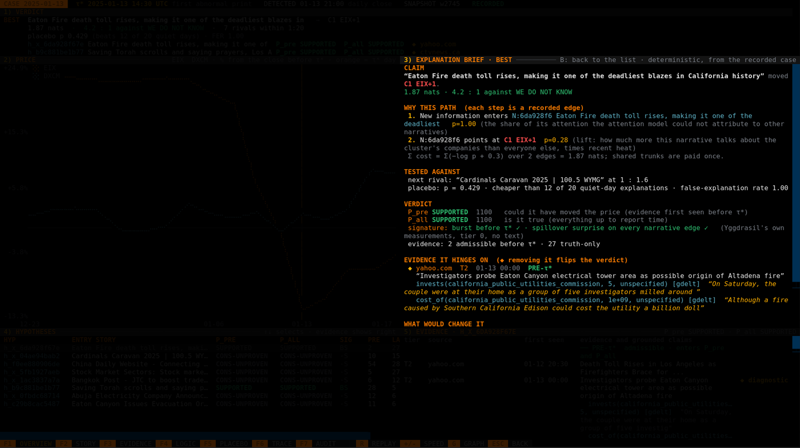
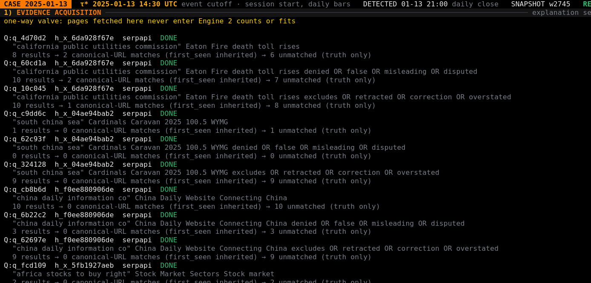

# Yggdrasil

*An attempt to explain market moves using only what was knowable at the time.*

**Quick links:**
- [Demo video, 2:43](https://cdn.jsdelivr.net/gh/notPhani/Yggdrasil-Research@96194e35dd0a65d5a35b467894cfe955f4ce075b/media/yggdrasil-demo.mp4)
- [Verify a recorded investigation in one command](#1-the-first-five-minutes)
- [One investigation, start to finish](#2-one-investigation-start-to-finish)
- [Claims audit](docs/claims-audit.md)
- [Blueprint](https://notphani.github.io/Yggdrasil-Research/blueprint/)

---

## I. The overture

On 27 January 2025, shares in Nvidia fell by about seventeen percent, and two of the power companies that had been bought as the electrical backbone of artificial intelligence fell further still. By the afternoon the explanation was settled. A Chinese laboratory called DeepSeek had released a reasoning model that appeared to match American systems at a fraction of the cost, and the market had concluded that the expensive infrastructure it had been pricing in might not be needed after all. The story was coherent, widely repeated, and probably right in its broad outline. What is interesting is how quickly it became impossible to see the day any other way.

That speed is the subject of this project. An event happens, and almost immediately an explanation forms around it. Headlines arrive, analysts write notes, people compare timelines, and within hours there is a version of events that feels less like a hypothesis than a description. Sometimes that version is correct. Sometimes it is wrong in ways nobody checks, because the price has already moved on. And sometimes it is assembled from material that did not exist when the event occurred: a follow-up report, a lawsuit filed weeks later, an interview given after the fact. Each of these is true, and none of them could have caused anything.

The past is not difficult to explain. It is difficult to explain without cheating.

Cheating, here, has a precise meaning. It means letting information from after an event into an account of why the event happened. Almost nobody does it on purpose. It happens because the tools we use to look backward are made of the present. A search engine queried today about a day in January returns what the web knows today, ranked by what has since become important, and the documents that turned out to matter are exactly the ones most likely to surface. Search is a time machine that only runs one way, and it is very good at producing explanations that are coherent precisely because they were written with the outcome in hand.

Coherence is the trap. A good story about a market move connects an announcement to a reaction through a chain of reasonable steps. Each step can be individually plausible while the chain as a whole was never in anyone's mind when the price changed. Markets also produce a great many events. On any given day thousands of stories are in circulation, and with enough of them it is almost always possible to find a chain that seems to lead to whatever happened. So the useful question is rarely whether an explanation can be found. It is whether this explanation is better than one the same procedure would have found on a day when nothing happened at all.

That reframing changes what an honest explanation has to look like. It has to name a moment, the point after which information no longer counts as a possible cause. It has to be built only from what was visible before that moment, and it has to record when each piece of evidence was first seen. It has to compete against alternatives, including the unglamorous alternative that nothing in the record explains the move. It has to say what it was tested against and what would change its mind. And it needs some way of knowing how often the same procedure invents a confident story out of noise. None of this guarantees a correct answer. It makes the answer the kind of thing that can be wrong in a checkable way.

There is a further difficulty that no amount of care with timestamps removes. Even a perfectly dated chain only shows that one thing was published before another and that attention moved in a particular order. It does not show that anyone traded because of it. Markets respond to information, but also to positioning, to flows, to rumours that never reach print, and to one another. A scientist who wanted to know whether a story moved a price would rerun the day without the story, and that experiment is not available. The closest substitute is to ask how the same procedure behaves on days when, as far as anyone can tell, nothing happened. If it finds equally convincing chains on those days, then the chain it found on the interesting day is telling us more about the procedure than about the market. That is what a placebo is for, and it is why an explanation without one sits closer to an anecdote than to a measurement.

People are very good at the first half of this work and poor at the second. We produce coherent stories without effort, and we find it almost impossible to forget what we already know about how things turned out. A machine has the opposite temperament. It can be made to respect a cutoff mechanically, to look for evidence against its preferred answer with the same diligence it applies to evidence for it, and to write down everything it did. If it is also deterministic, so that the same inputs always produce the same investigation, then an explanation stops being an argument one has to take on trust and becomes an artifact that someone else can rerun, inspect and break. That property matters more than any single result, because an explanation nobody can reproduce is also one nobody can show to be wrong.

Yggdrasil is an attempt to build that discipline into a working system. It keeps a running memory of what the world's news was paying attention to, built from the GDELT stream in fifteen-minute windows, with every document stamped with the moment it was first seen. It groups that stream into narratives and measures how attention moves from one narrative to another. When a stock moves abnormally, it does not ask the present why. It goes back to its own memory as it stood at the cutoff and searches for the cheapest chain of attention leading from new information to the stocks that moved. It weighs that chain against the option of not explaining the move at all, and it repeats the same search on twenty quiet days to see how easily such chains appear. Only then does it turn to the open web, through SerpApi. There it looks for evidence that would contradict each candidate as well as evidence that would support it, keeping a strict account of which results it had already seen before the cutoff and which it is only learning about now.

The results so far are modest, and they are reported as they came out. On 13 January 2025, the system's best account of a fall in Edison International and PG&E ran through a narrative about the Eaton Fire, resting on a report it had first seen fourteen and a half hours before the market opened. On 27 January, the day of DeepSeek, its cheapest chain ran through a narrative about helium drilling, which is not a credible explanation of anything, and its own checks declined to endorse it. On both days the placebo searches showed that chains as cheap as the winning one turn up on quiet days far too often for the chain alone to mean much. That is an uncomfortable finding and a useful one. It locates the weakness in a part of the method that can be measured, and it is the kind of result a system built to flatter its author would never have produced.

There is a smaller lesson in the same January case. One of the hypotheses that day passed every check the logic program knew how to make. It was a syndicated British newspaper review, which had certainly been published, and widely, before the market opened, and which had nothing to do with semiconductors. The rules had been asked whether a hypothesis's own event happened and was corroborated in time, not whether it mattered, and they answered the question they were asked. Many failures of explanation look like this when they are examined closely: a correct answer to a slightly different question.

Now we can talk about the machinery.

---

## II. The laboratory

Every statement below carries one of five labels. The full ledger, including the 14 places where earlier documentation claimed more than the code does, is in [docs/claims-audit.md](docs/claims-audit.md).

| Label | Meaning |
|---|---|
| **IMPLEMENTED** | The code does it |
| **TESTED** | A test in `tests/` establishes it |
| **RECORDED** | A historical replay produced it, and `ygg verify` re-derives it from the archived artifacts |
| **HYPOTHESIS** | A design claim not yet tested |
| **NOT VALIDATED** | No evidence either way |

### 1. The first five minutes

The repository ships a sanitized fixture of both recorded investigations, 3.7 MB in [`fixtures/replay/`](fixtures/replay/). You can inspect them without the 24.6 GB corpus, without network access, and without spending SerpApi credits.

```
git clone https://github.com/notPhani/Yggdrasil-Research && cd Yggdrasil-Research
python3 -m venv .venv && .venv/bin/pip install -e .
.venv/bin/ygg verify --data-dir fixtures/replay             # 11 checks, about 6 s, no network
.venv/bin/ygg show 2025-01-27 --data-dir fixtures/replay    # the recorded dossier
.venv/bin/ygg ui --data-dir fixtures/replay                 # the investigations in the terminal UI
```

This workflow was tested in a fresh clone and a fresh virtualenv, with every socket connection and DNS lookup in the process forced to fail: 11 of 11 checks passed. `tests/test_offline_verify.py` repeats it on every test run and also checks that a tampered fixture fails. In the terminal UI the investigations are fully inspectable offline. The live panels, the GDELT feed and the quotes, report that their sources are unavailable.

`ygg verify` re-runs production code on the archived inputs and compares the results with what was recorded:

| Check | What is re-run | What it establishes |
|---|---|---|
| manifest | sha256 of all 38 fixture files | The fixture is the recorded one |
| observer | `build_case` on the archived daily bars | Same fired set, clusters and event cutoff τ* |
| search | DPBF on the recorded explanation graph | Same optimal cost and tree, abstention cost, and every rival within ln 20 |
| verdicts | clingo on the recorded evidence facts | Same P_pre and P_all verdict and four bits for every hypothesis |
| placebo | p and FER from the recorded per-placebo costs | The reported statistics follow from the recorded runs |
| serpapi | the archived response for every sent query | All responses present, result counts match, no credential fields |

It does **not** re-run the GDELT replay (Engines 1 and 2). That needs the full corpus; see [section 7](#7-reproducing-everything).

### 2. One investigation, start to finish

The most instructive recorded case is the one where the system is wrong. On **27 January 2025** it finds a cheap explanation, some of the search results it gathers point the other way, and the verdict layer declines to endorse it. Every number below is recorded output, and `ygg verify` re-derives it.

**The event.**
- The observer works on daily bars and fired on 13 instruments in four clusters: chips {AVGO, CDNS, MRVL, NVDA, SMH, TSM, XLK}, power {CEG, NRG, PEG, VST}, {ASM.AS} and {COHR}.
- The largest moves were VST −28.3% (SAR −7.8), CEG −20.8% (SAR −5.9), MRVL −19.1%, COHR −18.9% and NVDA −17.0% (SAR −5.1).
- The event cutoff τ* is **08:00 UTC**, the start of the Amsterdam session, where ASM International opened −8.8%. τ* is derived from daily bars as the earliest session start in which the move could have printed. It is not an observed intraday print (see [§3.5](#35-the-observer)).

**Competing explanations.**
- The explanation graph at the τ* snapshot has 1,038 nodes and 8,173 edges.
- DPBF returns the exact minimum of the ranking objective, 3.917 nats:
  - BOT → "Pulsar Helium Announces Drilling Has Commenced…" (p = 0.547) → chips, power and COHR (p = 0.95 each).
  - BOT → "Zebrafish Protein Reactivates Repair Genes…" (p = 1.00) → ASM.AS (p = 0.256).
- "We do not know" costs 13.184 nats: 4 clusters × (−ln 0.05 + 0.3). Under the model's own probabilities, that puts the junk chain at 10,583 : 1 against abstention.
- Nine rivals lie within a factor of 20. They include "Tickets on sale for Norway Community Dinner and Dance" and "Supermodel Dayle Haddon Dead At 76".

**Scrutiny.**
- The graph score looks decisive, but the connections are absurd, which says something about the scoring rather than about the world.
- The p = 0.95 links come from the link score (§3.6). It adds an unbounded robust z-score of a narrative's last-day attention to its log-lift. A narrative reviving from near-zero attention has a tiny median absolute deviation, so its z explodes, and it takes almost all the softmax mass for every cluster.
- That cause comes from reading the code and has not been measured. It is listed as known failure F1.
- The narrative one would expect did exist. Narrative `4d4b5abe` was born at window 3437, on 20 January, hours after the R1 release, and held 70 DeepSeek-titled stories before the snapshot. It never won the links.

**SerpApi.**
- Each of the six distinct entry narratives became a hypothesis, and each got one confirming and two disconfirming Google searches built from its central subject.
- The subject is the most frequent organization in the hypothesis's documents, which for junk narratives gives odd results: `"google" Zebrafish Protein Reactivates Repair Genes` and `"avina clean hydrogen" Pulsar Helium Announces Drilling Has … denied OR false OR misleading OR disputed`.
- Of 18 planned queries, 15 were sent, 2 were skipped by the per-case cap, and 1 timed out. They returned 69 results.
- 3 results matched a document GDELT had already seen, and inherited its first-seen time. The other 66 had no earlier sighting and count only toward the retrospective question.
- One result title yielded a rule-extracted claim. None of it changed a verdict: the verdicts are identical before and after the searches. This is RECORDED; see §3.7 for why.

**Admissible versus retrospective.** Each verdict is computed twice.
- **P_pre** admits only reports first seen before τ*. When a page was fetched, its Wayback text must also date from before τ*.
- **P_all** admits everything up to report time.

**The verdict.**
- Five of the six hypotheses, including both halves of the winning chain, are **CONSISTENT-BUT-UNPROVEN** on both counts. Their entry narratives lacked Yggdrasil's own burst-and-spillover signature, so the logic program never derives `expl(H)`.
- The sixth, "What the papers say", is **SUPPORTED**. Its trigger event, a Press Association newspaper review syndicated to dozens of UK local sites, was reported, first seen before τ*, carried the signature, and was not contradicted. Its link to the move is p = 0.029.
- This is the clearest demonstration of what SUPPORTED does and does not mean (§3.7). It also exposes known failure F3: the source registry treats each local paper as an independent owner.

**The audit trail.**
- The case file records the observer statistics, the full searched graph, every tree, every hypothesis with every report and claim, every SerpApi query with its status and counts, and both verdict programs' outputs.
- The 15 SerpApi responses are archived and replay offline.
- The placebo record holds 20 costs: empirical p = 0.333, false-explanation rate 1.00.

**The contrast: 13 January 2025.**
- EIX and PCG fell at the US open. τ* is 14:30 UTC, the regular open, since neither gapped enough for the pre-market rule.
- The best chain is BOT → "Eaton Fire death toll rises…" → {EIX, PCG}, at 1.872 nats against 3.296 for abstention: 4.2 : 1 under the model, with seven rivals within 20 : 1.
- The verdict is SUPPORTED on both counts. The item whose removal flips it is a yahoo.com report, "Investigators probe Eaton Canyon electrical tower area as possible origin of Altadena fire", first seen 00:00 UTC, 14.5 hours before τ*.
- SerpApi sent 15 queries and skipped 9 by the cap. Of the results, 6 matched earlier GDELT sightings and 83 were truth-only. The truth-only side includes "Lawsuits allege power company involvement in LA wildfires" and later reports that the utility's equipment caused the fire. Those are true, but they fall on the far side of the τ* wall and cannot count toward P_pre.
- The placebo p is 0.43, with a false-explanation rate of 1.00.
- This is the system working as designed on a case where the story is plausible. The placebo result says the graph cost alone would not have distinguished it from a quiet day.



### 3. The machinery



#### 3.1 Clock, determinism and provenance

**What the code implements.**
- Time is a grid of 15-minute windows from an origin of 2024-12-16.
- An observation enters at ingested_time = observed_time + lag, rule D1. No stage reads the wall clock during replay.
- **D2:** random draws use Philox keyed by (cfg_hash, record ids).
- **D3:** floating-point reductions are order-independent.
- **D4:** ties break on (observed_time, source_rank, url_key, record_id).
- **D5:** non-deterministic calls (SerpApi, Wayback, prices) are archived and replayed.
- **D6:** artifacts are stamped with cfg_hash.
- **D7:** parameters fitted through day D−1 apply on day D. Code: [`determinism.py`](src/ygg/determinism.py).
- The replay checkpoints its full state every 3 days and resumes with `--resume`.
- Each snapshot manifest records its parent snapshot id and an inputs hash, computed as a streaming hash of the canonical state. Nothing yet verifies that chain end to end.

**TESTED.** D1–D7 (`test_determinism.py`), exact resume from a pickled snapshot (`test_engine2a.py`), and state independence from `PYTHONHASHSEED` across two processes (`test_seed_independence.py`, which fails if the sorted-order fix is reverted).

#### 3.2 Engine 1: observation

**What the code implements.** It ingests the GDELT 2.0 English GKG stream for 2024-12-16 to 2025-01-31: 13,533 files, 24.6 GB, md5-verified. Code: [`observation/`](src/ygg/observation/).
- **Parse.** Each raw file is parsed into a cache keyed by (parser version, blob sha256).
- **L1, exact dedup.** Duplicates are dropped by native id, then by canonical URL key.
- **L2, semantic dedup.** It runs in time order. Step 1 merges an exact normalized-title match when the image, author or entity names (Jaccard ≥ j0) agree. Fallback A merges a title-embedding match when cosine ≥ θ_a, using potion-base-8M, together with name overlap.
- Each document carries `first_seen`, the window in which Yggdrasil first saw it. Missing GDELT batches are flagged and masked.

**RECORDED.** 5.80M rows became 5.77M unique objects after L1, then 4.01M stories after L2 merged 1.76M syndicated copies. One GDELT batch was missing, flagged and masked.

**Limits.** GDELT is English-only here. `first_seen` is when GDELT surfaced a URL, which can lag publication.

#### 3.3 Engine 2a: narratives

**What the code implements.** Each event cluster c, a group of near-identical stories, is one draw of a narrative. It has a unit mean title direction x_c from MiniLM (all-MiniLM-L6-v2, 384-d) and an entity profile w_c(e). Code: [`narratives/learned.py`](src/ygg/narratives/learned.py). The score of narrative k against the background is

$$
g_k = \log\pi_k - \log\pi_0 + \big[\log C(\kappa_s) + \kappa_s\,\mu_k^\top x\big] - \big[\log C(\kappa_0) + \kappa_0\,\mu_0^\top x\big] + \tfrac{1}{T}\sum_e w(e)\log\frac{\phi_k(e)}{\phi_0(e)} - \frac{(t-t_k)^2}{2\sigma^2},
$$

where the entity distribution is Dirichlet-smoothed toward the corpus, $\phi_k(e) = (n_k(e) + \beta\,\phi_0(e))/(N_k+\beta)$, and $\phi_0$ is a trailing 7-day document frequency.

Soft memberships are the posterior over the top three narratives plus a null narrative, stored as uint8 values summing to 255.

**Births, merges and splits** are closed-form conjugate Bayes-factor tests in nats. Each narrative costs $-\log\alpha$. A birth needs a group of at least two distinct events whose vMF evidence beats the background:

$$
\log\alpha + \log Z_{\text{vMF}}(G) - \sum_{e\in G}\log p_0(x_e) + \tfrac{1}{T}\,\text{DM}(G) > 0,\qquad
\log Z_{\text{vMF}}(S,n) = n\log C(\kappa_s) + \log C(\kappa_0) - \log C(\lVert\kappa_s S + \kappa_0\mu_0\rVert).
$$

Merges and splits compare the same evidence for the joined and separated groups. A merge or a split must win three consecutive 6-hour checks.

**Adaptive price.** $\log\alpha$ becomes $\log\alpha - \rho\log(V_{6h}/V_{7d}) - \text{cap}(K_{\text{alive}})$, scaled by a measured tail constant of 31 nats. Above 300 alive narratives, splits pause, and a birth sends the least-recently-active narrative dormant.

**Parameters, with status.**
- **Chosen by the prequential score:** κ_s = 250. The score rose monotonically to 250, the edge of the grid; the data-implied κ is 280–310.
- **Defaults, not fitted:** log α = −15 and T = 2.
- **Hand-set:** β, dormancy after 7 days, σ = 336 h, the 300 ceiling and 3-check hysteresis.

**TESTED.** Bessel and vMF numerics, the adaptive-price terms, hysteresis, the ceiling and eviction (`test_learned.py`, `test_adaptive_price.py`).

**RECORDED.** On 27 Jan the model held 300 alive and 746 dormant narratives. The ceiling binds, so eviction is part of the dynamics. The first unrestricted run had 2,091 narratives alive by day 2, through a split cascade.

**Limits.** At the ceiling, unrelated stories can be absorbed into existing narratives, so a narrative's label, the title of one representative story, can misdescribe its contents.

#### 3.4 Engine 2b: attention

**What the code implements.** It models per-narrative story counts y_i(t) on the 15-minute grid. Code: [`attention/`](src/ygg/attention/).

$$
z_{jm}(t) = a_m z_{jm}(t-1) + (1-a_m)\,y_j(t-1),\quad a_m = e^{-15\,\text{min}/\tau_m},\ \tau_m \in \{1\text{h}, 6\text{h}, 1\text{d}, 1\text{w}\}
$$

$$
\eta_i(t) = b_{0i} + c_i(\text{how}) + \sum_{j\in K(i),\,m} A_{ijm}\,z_{jm}(t),\qquad
\lambda_i = s\,\text{softplus}(\eta_i/s)\cdot\Big(\frac{B}{B+S_{\text{raw}}}\Big)^{\omega}
$$

- **Fitting.** Rows are fitted daily on data strictly before the day: a quasi-Poisson loss with a sparse group lasso on A, solved by FISTA with a fixed iteration count. Each row uses its 20 nearest narratives and 10 Fourier hour-of-week terms.
- **Competition.** ω and β_B are profiled weekly on a held-out day over the grid ω ∈ {0, 0.25, 0.5, 0.75, 1}. The replay selected ω = 0.25.
- **Bursts.** Randomized PIT residuals under NB2(λ, r) feed a BOCPD changepoint detector with a hazard of 1/288, about 3 days. A window is flagged as a burst when the posterior favours a short run.

**Attribution.** When y_i(t) > 0, the predicted part splits across the positive excitations e_{ij} from parent narratives, and everything unexplained goes to **BOT**, the external source:

$$
\alpha_{i\leftarrow j}(t) = \frac{\min(y,\lambda)}{y}\cdot\frac{e_{ij}^{+}}{b^{+}+\sum_k e_{ik}^{+}},\qquad
\alpha_{i\leftarrow\text{BOT}}(t) = \frac{\min(y,\lambda)}{y}\cdot\frac{b^{+}}{b^{+}+\sum_k e_{ik}^{+}} + \frac{(y-\lambda)^{+}}{y}.
$$

These shares are timing statistics of a predictive model. They are not causal effects.

**RECORDED.** On 27 Jan: 8,734 attention edges, and a BOT share of 52% of attention.

#### 3.5 The observer

**What the code implements.** Code: [`observer/trigger.py`](src/ygg/observer/trigger.py). For each instrument it uses a market model against SPY, estimated on trading days [t−260, t−11]:

$$
AR = R - (\hat\alpha + \hat\beta R_{\text{SPY}}),\qquad SAR = AR/\hat\sigma_{\text{pred}}.
$$

$M_z$, $M_v$ and $M_g$ are robust z-scores of AR, log volume and the opening gap. An instrument **fires** when $(|SAR|\ge 4 \lor |M_z|\ge 5) \land (M_v \ge 3.5 \lor |M_g|\ge 5)$. Fired instruments are clustered when their estimation-window residuals correlate at ρ ≥ 0.4 with the same sign. The universe is 149 names, frozen at 2024-12-31.

**The event cutoff τ*.** The gate uses **daily bars**, so no intraday print is observed. τ* is the start of the earliest session in which a fired instrument could have shown the move:
- the pre-market open, 04:00 ET, for a gap shock with |M_g| ≥ 5;
- otherwise the regular open, 09:30 ET;
- and 09:00 local for Amsterdam.

Because the true move happens at or after τ*, evidence first seen before τ* predates the move. Evidence published between τ* and the actual intraday move is excluded, which is conservative. A case opens at the daily close.

**TESTED.** Both recorded cutoffs and summer time (`test_event_cutoff.py`). The Amsterdam open was hard-coded to winter time until this audit.

**RECORDED.** The 2024 acceptance run opened cases on 122 of 252 trading days, mostly earnings, and needed at most 8 search terminals on 251 of 252.

#### 3.6 Engine 3a: explanation search

**What the code implements.** Code: [`search/`](src/ygg/search/).
- **The graph.** It is built on the snapshot frozen at τ*, from narratives active in [τ* − 14 d, τ*).
- **Edges between narratives.** They are recency-weighted attribution shares, tilted toward edges with surprising recent spillover:

$$
p_H(j\to i) = \frac{\sum_t w_t\,y_i(t)\,\alpha_{i\leftarrow j}(t)}{\sum_t w_t\,y_i(t)},\quad w_t = e^{-(\tau^*-t)/3\text{d}},\qquad
p^*(j\to i) \propto p_H\,e^{\gamma\max(0,\sigma_{ji})}
$$

  These are renormalized together with BOT → i, with γ = 0.5. Here σ is a robust z of the last 24 hours' mean α against earlier daily means.
- **Edges to the moved clusters.** They come from a lift statistic: how much more a narrative's stories mention the cluster's companies than everyone else's, plus an attention-surprise term:

$$
\text{lift}_{u,x} = \frac{A_u(T_x)/A_u}{A(T_x)/A},\qquad
p_{\text{link}}(u\to x) = (1-p_0)\,\operatorname{softmax}_u\big(\log(\text{lift}_{u,x}+\epsilon) + z^{\text{att}}_u\big).
$$

  $z^{\text{att}}_u$ is unbounded. That is known failure F1.
- **Costs.** Each edge costs $c(e) = \lfloor 1000(-\ln p(e) + \lambda) \rceil$ milli-nats, with λ = 0.3. The abstention edge BOT → x costs $-\ln p_0 + \lambda$, with p_0 = 0.05.
- **Search.** DPBF, the Dreyfus–Wagner dynamic program, computes the **exact minimum-cost arborescence** from BOT that spans every cluster terminal, for up to 8 terminals per group.
- **Rivals.** For each entry narrative, the cheapest explanation containing it, kept when within ln 20 of the optimum (Lemma 11.2).

This is the exact optimum of a **ranking objective** defined by the model's probabilities. It is the cheapest chain under the model, not a finding about cause.

**Placebos.** The cutoffs come from a keyed Philox stream (D2), so they are reproducible from the config rather than picked by hand. The plan file, [`fixtures/replay/cases/plan.json`](fixtures/replay/cases/plan.json), is dated 7 Oct, before any case ran. That date is a file timestamp, not a cryptographic commitment.
- **Cutoffs:** 20, from trading-hour windows on days when nothing fired.
- **Terminals:** each placebo uses the same number of terminals as the real case, built from instruments with |SAR| < 1.
- **Reported statistics:**
  - the **empirical p**, $(1 + \#\{c_{\text{placebo}} \le c_{\text{real}}\})/(1+K)$;
  - the **false-explanation rate**, the share of placebo terminals given a non-abstention explanation, with a target of 0.05;
  - **hub frequencies.**
- Each placebo search is memoised under its snapshot id, terminals and search configuration.

**TESTED.** DPBF optimality against brute force (`test_dpbf.py`), the placebo memo (`test_placebo_cache.py`), and re-solving the recorded graphs (`ygg verify`).

**RECORDED.** Across 42 searches, 2 real and 40 placebo, abstention won on **no** terminal. Both days have a false-explanation rate of 1.00. With p_0 = 0.05 and λ = 0.3, a chain through a 700-to-1,000-node graph is almost always cheaper than "we do not know". That is known failure F2.

#### 3.7 Engine 3b: evidence, SerpApi and verdicts

**Hypotheses.**
- There is one hypothesis per distinct entry narrative among the best tree and the rivals.
- Its **trigger event** is the entry narrative's largest event cluster in the 48 hours before τ*. Its documents, up to 60, are the base evidence.
- The six highest-tier documents are fetched from the Wayback Machine at or before τ*.
- Code: [`verdicts/engine3b.py`](src/ygg/verdicts/engine3b.py).

**Claims.** Claims are rule-extracted, deterministic and typed (subject, predicate, value, scope, polarity).
- **Stage 1** comes from GDELT's own amounts and quotations.
- **Stage 2** uses title patterns. A claim survives only if its span occurs verbatim in a fetched page (rule A5).
- The predicate vocabulary, which includes released, ranks_top, restricts_exports, capability_parity, cost_of, invests, denies and alleges, was written with the DeepSeek case in mind. It is a hindsight-shaped lexicon.
- An NLI-and-GLiNER verifier exists in [`verifier.py`](src/ygg/verdicts/verifier.py) but is **not wired in**. No recorded verdict used it.

**SerpApi.** Code: [`verdicts/serpapi.py`](src/ygg/verdicts/serpapi.py).

| Step | What the code does |
|---|---|
| Subject | The most frequent organization or name in the hypothesis's documents, a frequency heuristic |
| Queries | `"<subject>" <label>` to confirm, `… denied OR false OR misleading OR disputed` and `… excludes OR retracted OR correction OR overstated` to disconfirm |
| Time fence | The first two are date-bounded with `tbs=cdr` to [τ* − 14 d, τ*]; the third is unbounded |
| Request | `engine=google, num=10, hl=en, gl=us` |
| Dating | Each result is joined to Engine 1 by canonical URL. A match inherits GDELT's `first_seen` and is admissible to P_pre if that time precedes τ*. An unmatched result counts toward P_all only. |
| Claims | Extracted from the result **title** only, with the stage-2 rules. No page text is fetched for search results. |
| Role in the logic | Results enter as claims, **never** as witnesses that the trigger event occurred (`witness=False`). A claim affects a verdict only by being contrary to a hypothesis's central claims, from an independent source of equal or better tier. |
| Valve | Results never feed back into Engines 2a and 2b |
| Archive | Responses are parsed, stripped of credential fields, scrubbed of the key, and only then written to a content-addressed store. A final check refuses to write if the key survives (`test_serpapi_sensor.py` uses a fake key echoed in three places). |
| Budget | 15 searches per case, best explanation first; skipped and failed queries are recorded |

The strongest argument for this design isn't the volume of search. It's that search runs inside a constrained investigation with explicit evidence rules: dated, deliberately disconfirming, archived and replayable. It isn't handed to a language model to write a plausible story.

The honest measurement of its effect so far: across both cases, 158 results, 13 rule-extracted claims, and **no verdict changed**. That is RECORDED. The searches documented the retrospective record, including the lawsuits that sit on the far side of the τ* wall on 13 January. None of them produced a contrary claim the rules could use. A claim extractor that reads beyond titles is the obvious next step (question Q5).

**The verdict program.** It is a tight normal logic program, solved with clingo ([`verdicts/program.py`](src/ygg/verdicts/program.py)). Its core rules:

```prolog
ok(R)       :- reported(R,_,_,_), not defeated(R).
holds(L)    :- reported(R,_,L,_), ok(R).
defeated(R) :- reported(R,S,L,_), contrary(L,L2), reported(R2,S2,L2,_), ok(R2),
               independent(R,R2), tier(S,K), tier(S2,K2), K2 <= K.
defeated(R) :- copy_of(R,_).
refuted(H)  :- schema_refuter(H,L), holds(L).
corroborated(E) :- reported(R,S,occurred(E),_), ok(R), tier(S,K), K <= 2.
corroborated(E) :- reported(R1,_,occurred(E),_), ok(R1), reported(R2,_,occurred(E),_), ok(R2), independent(R1,R2).
expl(H) :- trigger(H,E), holds(occurred(E)), corroborated(E), before(E,move), signature_ok(H), not refuted(H).
```

Four bits per hypothesis come from brave and cautious reasoning over stable models: bIN, cIN, bOUT and cOUT. **SUPPORTED** iff cIN, **CONTRADICTED** iff cOUT, **UNRESOLVED** iff bOUT ∧ ¬cOUT, otherwise **CONSISTENT-BUT-UNPROVEN**.

**What SUPPORTED means, exactly.** The hypothesis's own trigger event was reported and corroborated, it was first seen before τ*, the entry narrative had Yggdrasil's burst and positive spillover signature, and no contrary claim survived. It does **not** test whether the event bears on the moved stocks. The 27 January "What the papers say" case shows the consequence.

**Assumptions encoded in the rules.**
- Sources come in three frozen tiers: primary/.gov, national wires and everything else.
- Independence means a different owner *and* a different copy group. Owners map most domains to themselves, which is known failure F3.
- Copies are defeated.
- Contradiction is computed by rules, never by a model.

**TESTED.** Verdict semantics and tightness (`test_verdicts.py`, `test_engine3b.py`), claim rules (`test_claims.py`), and the SerpApi sensor (`test_serpapi_sensor.py`).

**RECORDED.** Every verdict in both cases is re-derived by `ygg verify`.

#### 3.8 The terminal

`ygg ui` is the working surface: a live control panel and an investigation workspace with seven tabs. The tabs are overview, story, evidence, logic, placebo, SerpApi trace and audit. It adds a recorded replay that reveals each stage only after the clock passes the moment it became knowable, a click-through brief for every explanation, a browser graph window linked to the terminal at 127.0.0.1:8765, and a presenter mode. Investigations display recorded state only. Nothing is recomputed for display.





### 4. The experimental record

| | 13 Jan 2025 (EIX, PCG) | 27 Jan 2025 (DeepSeek) |
|---|---|---|
| Fired / clusters / τ* | 2 / 1 / 14:30 UTC (regular open) | 13 / 4 / 08:00 UTC (Amsterdam open) |
| Graph | 715 nodes, 3,116 edges | 1,038 nodes, 8,173 edges |
| Best chain | Eaton Fire narrative → {EIX, PCG} | Pulsar Helium and Zebrafish narratives → four clusters |
| Cost vs abstention | 1.872 vs 3.296 nats (4.2 : 1) | 3.917 vs 13.184 nats (10,583 : 1) |
| Rivals within 20 : 1 | 7 | 9 |
| Verdicts (P_all) | 2 SUPPORTED, 6 unproven | 1 SUPPORTED ("What the papers say"), 5 unproven |
| SerpApi | 15 sent, 9 capped, 6 matched, 83 truth-only | 15 sent, 2 capped, 1 timeout, 3 matched, 66 truth-only |
| Verdicts changed by SerpApi | none | none |
| Placebo p, FER | 0.429, 1.00 | 0.333, 1.00 |

**What the record shows (RECORDED):**
- The full pipeline runs end to end on a 29-day replay.
- On a case with a plausible story, the cheapest chain is plausible.
- On a case where it is junk, the verdict layer does not endorse the junk chain.
- The placebo layer measures, and reports, that graph cost alone is not diagnostic.

**What it does not show (NOT VALIDATED):**
- Accuracy over a population of events. There are two cases, examined after the fact.
- That the method recovers known causes.
- That abstention behaves sensibly.
- That the verdict rules separate relevant events from irrelevant ones.

**Known failures.** All are documented, and none was patched after it was observed.

| | Failure | Evidence | Status |
|---|---|---|---|
| F1 | The link score adds an unbounded robust z of last-day attention, so a reviving dormant narrative takes the links | 27 Jan p = 0.95 links | Likely cause from code reading, not measured |
| F2 | Abstention never wins | FER 1.00 on both days; 0 of 42 searches | RECORDED |
| F3 | SUPPORTED does not test relevance, and syndicated copies can corroborate each other | 27 Jan "What the papers say" | RECORDED |
| F4 | The claim lexicon was shaped by the DeepSeek case, and claims are read from titles | Code | IMPLEMENTED |
| F5 | SerpApi evidence changed no verdict | Both cases | RECORDED |
| F6 | τ* comes from daily bars, not intraday prints | Code | IMPLEMENTED, by design |

### 5. Open research questions

Each question has a test that would answer it. None should be tuned on the two cases above.

1. **Q1 Abstention.** Calibrate p_0 and λ so that the false-explanation rate on quiet cutoffs approaches 0.05. Evaluate on held-out days.
2. **Q2 Link score.** Bound $z^{\text{att}}$, for example with a MAD floor or a clip, and measure the placebo p and FER on events not yet inspected.
3. **Q3 Relevance.** Require in `expl(H)` that the hypothesis's link to the moved cluster clears a threshold. Measure how many SUPPORTED verdicts survive.
4. **Q4 Independence.** Map real ownership groups and count each wire story once.
5. **Q5 Claims.** Replace the title lexicon with a case-agnostic extractor, and wire in and evaluate the existing NLI verifier, so that SerpApi results can contradict. Measure how often verdicts change.
6. **Q6 Timing.** Use intraday bars to locate the first abnormal print, and measure how much evidence the session-start cutoff excludes.

### 6. Tests

`pytest -q` gives **93 passed**, run on 12 Oct 2026, both in the working tree and in a fresh clone without `data/`. They cover:
- determinism rules D1–D7, seed independence and exact resume;
- contracts and red-team cases from the blueprint audit;
- Engine 1 dedup;
- the narrative model numerics, adaptive price, hysteresis and ceiling;
- attention fitting;
- DPBF optimality;
- verdict semantics;
- the SerpApi sensor, including key sanitization;
- the event cutoff;
- the placebo memo;
- offline verification, including the tampered-fixture failure.

### 7. Reproducing everything

```
python3 -m venv .venv && .venv/bin/pip install -e ".[dev]"
.venv/bin/ygg fetch                  # GDELT 2.0 English stream, 2024-12-16 .. 2025-01-31: 13,533 files, 24.6 GB, md5-verified, resumable
.venv/bin/ygg ingest                 # Engine 1: parse, canonical URLs, L1 + L2 dedup, clocks, missing-batch flag
.venv/bin/ygg embed-import DIR --release embeddings-minilm-v1   # MiniLM title vectors computed on a GPU (sha256, id order, CPU parity checked)
.venv/bin/ygg replay [--resume]      # Engines 2a + 2b, window by window, checkpoint every 3 days
.venv/bin/ygg case 2025-01-13        # observer + Engine 3a: clusters, tau*, best tree, rivals, abstention, 20 placebos
.venv/bin/ygg verdict 2025-01-13     # Engine 3b: hypotheses, evidence, SerpApi, claims, clingo verdicts, dossier
.venv/bin/ygg verify                 # re-check every case in data/ the same way as the fixture
python scripts/make_fixture.py       # rebuild fixtures/replay from data/
```

- **Data and compute.** The recorded replay processed 30 Dec 2024 to 27 Jan 2025, on a clock that starts 16 Dec. It was stopped after 27 Jan was written, so 28 Jan was not replayed. It ran at 4–27 minutes per day on 2 threads, with a peak of about 9 GB of memory when loading a checkpoint.
- **SerpApi.** Set `SERPAPI_API_KEY`, or put the key in `~/.config/serpapi/key`. Without it, queries are recorded as UNAVAILABLE. Re-running `ygg verdict` after adding a key needs no replay.
- **Remote machine.** Forward the graph window with `ssh -L 8765:localhost:8765 host`.

### 8. Documents

| Document | What it holds |
|---|---|
| [Blueprint](https://notphani.github.io/Yggdrasil-Research/blueprint/) | The locked architecture: every formula, the decision ledger the code cites by number, parameter sensitivity, stability arguments and extreme cases |
| [Research brief](https://notphani.github.io/Yggdrasil-Research/brief/) | Findings and Manim animations of the attention model, attribution and search |
| [Report](reports/Yggdrasil%20attention%20model%20and%20search.md) | The architecture as mathematics, with proofs and a ledger of cited theorems, each labelled PROVEN, DERIVED, CONJECTURE, MEASURED or EMPIRICAL |
| [Research notes](research_notes/Yggdrasil%20attention%20model%20and%20search/) | Six tracks: point processes, conservation, formal evidence reasoning, search guarantees, ingestion, market attribution |
| [Claims audit](docs/claims-audit.md) | What the code, tests and records do and do not establish |

The documents describe the full design, which goes further than the build in three places: Lean certification of verdicts, a push-style search certificate, and Levin tree search. Those are not implemented here.

### Disclosures

- **AI tools.** Claude (Anthropic), through Claude Code, was used as a research and engineering partner for literature review, implementation, profiling, testing, red-teaming and this audit. The author directed the research and made the architecture decisions.
- **Models.**
  - all-MiniLM-L6-v2 for narrative embeddings, computed on a local GPU and parity-checked on CPU.
  - potion-base-8M for semantic dedup.
  - The NLI cross-encoder and GLiNER named in `verifier.py` are not used in any recorded result.
- **Data.**
  - GDELT 2.0 (public).
  - Daily bars from the Yahoo chart API, an unofficial endpoint, with responses archived.
  - Wayback Machine snapshots.
  - **SerpApi:** 30 searches on the free plan, all archived. The fixture keeps position, title and link.
- **Prior work.** The design documents in `blueprint/`, `brief/`, `reports/` and `research_notes/` came before the hackathon build. The code in `src/` was written for it.

MIT License. See `LICENSE`.
