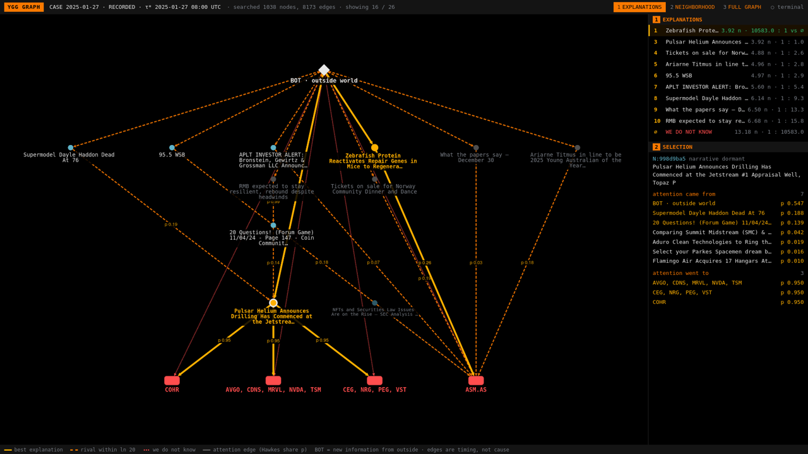
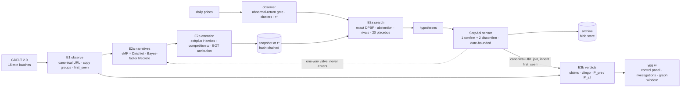
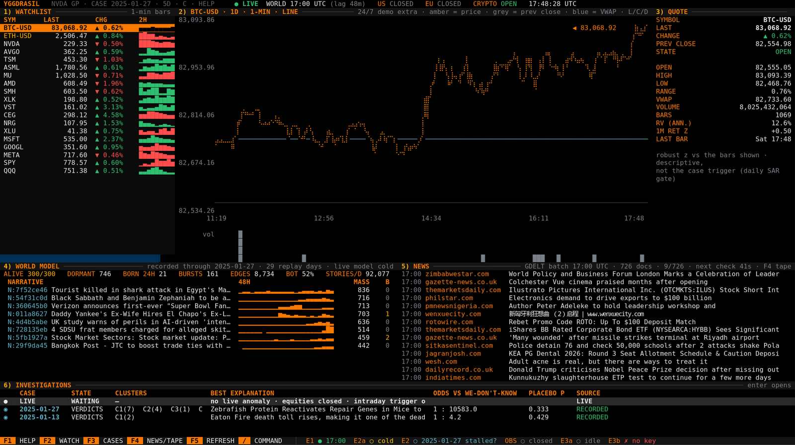
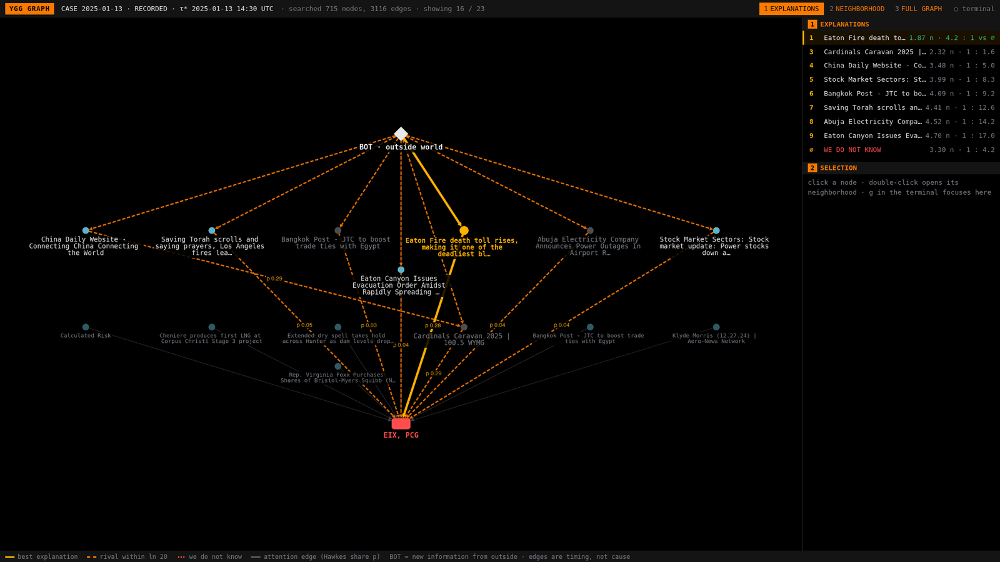
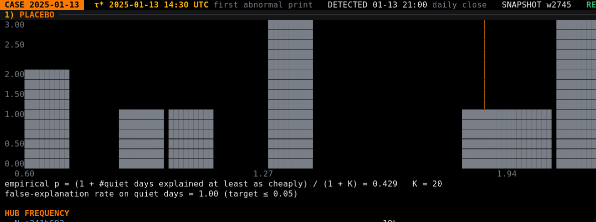

# Yggdrasil

**Search engines know the future. Yggdrasil makes search evidence time-honest.**

Yggdrasil is a market event forensics engine. When a stock moves abnormally, it reconstructs which public information plausibly moved it, **using only what was public before the move**. It weighs that explanation against an explicit "we do not know", checks it against the open web through **SerpApi**, and replays every step deterministically.

SerpApi India Hackathon 2026 · Open Innovation · Python 3.12 · 86 tests · deterministic replay

[](https://cdn.jsdelivr.net/gh/notPhani/Yggdrasil-Research@af0be399b54fd24cba1580a83eedbf8fbbf3e377/media/yggdrasil-demo.mp4)

**Demo video, 2:43:**
- [Watch in the browser](https://cdn.jsdelivr.net/gh/notPhani/Yggdrasil-Research@af0be399b54fd24cba1580a83eedbf8fbbf3e377/media/yggdrasil-demo.mp4)
- [The file in this repo](media/yggdrasil-demo.mp4)

---

## The insight

Every "why did this stock move" answer is written after the move, against an internet that already contains the outcome. If you search today for why Edison International fell on 13 January 2025, you get lawsuits filed weeks later. They are true, but they were not public when the price moved.

Yggdrasil separates two questions that everyone else merges:

| Question | Evidence allowed | Verdict |
|---|---|---|
| **Could it have moved the price?** | Only what Yggdrasil saw **before τ***, the first abnormal print | P_pre |
| **Is it true?** | Everything, up to report time | P_all |

It also refuses to force a story. "We do not know" is a candidate in every search, with a computed cost, and it wins when the evidence is thin.

## Who it is for

| User | What they get |
|---|---|
| **Market surveillance and compliance** | A move with **no** public explanation from before τ* is exactly the case a surveillance team reviews. Yggdrasil says "we do not know" with numbers attached instead of inventing a story. |
| **Analysts and risk desks** | A ranked set of competing explanations, each with dated evidence and the item its verdict hinges on, not one confident paragraph. |
| **Financial journalists** | Which sources had the story first, and when, with copies and syndication folded together. |
| **Quant researchers** | Event explanations free of look-ahead, usable as labels without leaking the future into a backtest. |

## What is new

| | Dated evidence | Abstains | Calibrated | Replayable | Uses search |
|---|---|---|---|---|---|
| "Why is it moving" blurbs | no | no | no | no | indirectly |
| Event studies | n/a | n/a | yes, for the return only | yes | no |
| LLM search-and-summarize agents | no, live index | rarely | no | no | yes, unfenced |
| **Yggdrasil** | **yes, first_seen per item** | **yes, a costed candidate** | **yes, 20 placebos** | **yes, bit for bit** | **yes, SerpApi fenced at τ*** |

Each piece below exists in the literature. The combination does not, as far as we know:
- Hawkes-process attention attribution.
- Exact Steiner-tree explanation search with an abstention candidate.
- Placebo calibration.
- Logic-program verdicts over time-fenced search evidence.
- One deterministic replay that ties all four together.

## How SerpApi powers it

SerpApi is Yggdrasil's **targeted evidence sensor**. The GDELT stream says what the world was paying attention to. SerpApi says what the open web holds about each specific hypothesis. Without it, the verdicts rest on the broad stream alone.


| Step | What happens |
|---|---|
| **Confirm and disconfirm** | Per hypothesis, three Google queries through SerpApi, built from its central subject: **one confirming and two disconfirming**, written to break the story. |
| **Look-ahead fence** | Two of the three are date-bounded with `tbs=cdr` to [τ* − 14 d, τ*]. |
| **Timing provenance** | Each result is joined to the GDELT stream by canonical URL and **inherits the time Yggdrasil first saw it**. Only evidence first seen before τ* can enter P_pre. Unmatched results support P_all only. |
| **One-way valve** | Search results never feed back into the narrative or attention models, so targeted search cannot contaminate the world model. |
| **Archive and replay** | Every response is stored in a content-addressed blob store, and no archived file contains the API key (checked). Reruns, replays and the terminal read the archive and spend zero searches. |
| **Budget** | At most 15 searches per case, best explanation and top rivals first. Skipped queries are recorded, not hidden. |
| **In the product** | The **F6 trace** tab shows every query and its matches. The **F3 evidence** tab draws the τ* wall through the results. |


Measured on the recorded cases, using the free plan's 250 searches a month:

| Case | Searches sent | Skipped by the cap | Matched an earlier GDELT sighting | Truth only |
|---|---|---|---|---|
| 13 Jan 2025, EIX + PCG | 15 | 9 | 6 | 83 |
| 27 Jan 2025, DeepSeek day | 15 | 2 | 3 | 66 |

## Architecture



| Engine | What it does | Code |
|---|---|---|
| **E1 observe** | GDELT 2.0 GKG in 15-minute batches. Canonical URLs, exact dedup, syndicated copies folded into copy groups, and a `first_seen` on every document. | [`src/ygg/observation/`](src/ygg/observation/) |
| **E2a narratives** | A von Mises–Fisher mixture over MiniLM title embeddings, combined with a Dirichlet entity mixture. Births, merges and splits are closed-form Bayes-factor decisions with 3-check hysteresis, an adaptive birth price and a 300-narrative ceiling. | [`src/ygg/narratives/`](src/ygg/narratives/) |
| **E2b attention** | A discrete softplus Hawkes process with memory traces and divisive competition ω. Attribution shares become edges, and unexplained attention goes to BOT, meaning new information. | [`src/ygg/attention/`](src/ygg/attention/) |
| **Observer** | A market-only abnormal-return gate, clusters by residual correlation, and τ* as the first abnormal print. | [`src/ygg/observer/`](src/ygg/observer/) |
| **E3a search** | An exact node-weighted Steiner tree (DPBF) from BOT to the moved clusters. Each edge costs −ln p + 0.3. Rivals within 20 : 1 are reported, the abstention candidate is always present, and 20 placebos are run. | [`src/ygg/search/`](src/ygg/search/) |
| **E3b verdicts** | Hypotheses, then SerpApi evidence, claims and clingo stable models, giving four verdict bits for P_pre and P_all and a dossier. | [`src/ygg/verdicts/`](src/ygg/verdicts/) |
| **Terminal** | `ygg ui`: a live control panel, an investigation workspace, a recorded replay, a browser graph window and presenter mode. | [`src/ygg/ui/`](src/ygg/ui/) |

## Engineering

| Measure | Value |
|---|---|
| GDELT ingested | 13,533 files, 24.6 GB, md5-verified |
| Engine 1 | 5.80M rows → 5.77M unique → **4.01M stories**, after folding 1.76M syndicated copies |
| World model on 27 Jan | **300** live narratives, 746 dormant, **8,734** attention edges, BOT share 52% |
| Jan 13 search graph | **713** narratives, **3,116** edges; 227 can reach the moved cluster |
| Jan 27 search graph | 1,038 nodes, 8,173 edges |
| 2024 acceptance run | Cases on 122 of 252 trading days; search terminals k ≤ 8 on 251 of 252 days |
| Tests | 86: determinism, contracts, red-team cases, engines, SerpApi sensor, placebo memo |

**Engineering highlights:**
- **Deterministic replay.** Entity weights were being summed in set order, which made results depend on `PYTHONHASHSEED`. They are now summed in sorted order, and state hashes are verified identical across seeds. Snapshots are hash-chained, and the replay checkpoints every 3 days and resumes under a supervisor.
- **Memory.** Hashing the snapshot state built a roughly 5 GB string and got the replay killed for running out of memory. It is now a streamed hash with an identical digest.
- **Faithful speedup.** A profiled day went from 528 s to 214 s, about 2.5x, with every output table identical. The gains came from vectorized negative-binomial and normal transforms across narratives, cached rows and a contiguous parameter matrix.
- **Placebo memo.** Each placebo search is memoised under its snapshot id, terminals and search config. Placebos run while the replay is still writing later days, and cached results equal uncached ones.
- **Verdict pipeline.** Evidence pages are prefetched from the Wayback Machine concurrently, which cut a verdict from over 15 minutes to 4.5 minutes.

## The product



**The live control panel:**
- A watchlist with one-minute bars and a quote.
- The live GDELT feed, with its lag shown honestly.
- The world model.
- The investigations list.
- Engine status, with `F4` switching to the event tape.


**The investigation workspace:**
- The verdict, the cluster price chart, ranked explanations, hypotheses and evidence.
- Click any explanation for its **brief**: the claim, why this path (every recorded edge with its p), what it was tested against, the verdict, the evidence it hinges on, what would change it, and its limits.
- `F1`–`F7` switch between overview, story, evidence, logic, placebo, SerpApi trace and audit.
- `R` replays the case from recorded state; nothing is recomputed.



**The graph window** at http://127.0.0.1:8765/ is linked live to the terminal. It has three views: explanations, neighborhood and the full graph.

## Results

**13 Jan 2025, Edison International and PG&E.**
- Best chain: "Eaton Fire death toll rises" into the EIX + PCG cluster, at **4.2 : 1 against "we do not know"**, with seven rivals within 20 : 1.
- P_pre and P_all are both SUPPORTED. The verdict hinges on a yahoo.com item ("Investigators probe Eaton Canyon electrical tower area…") first seen **14.5 hours before τ***.

**27 Jan 2025, DeepSeek-R1.**
- The trigger fired on 13 instruments in four clusters: chips, power producers, ASM International and Coherent. τ* is 08:00 UTC, the Amsterdam open.
- The cheapest chain is not credible: a dormant "Pulsar Helium" narrative links to three clusters at p = 0.95.
- The safeguards hold. Placebo p = 0.33, and the hypotheses are CONSISTENT-BUT-UNPROVEN, so the system does not endorse it.



**What the placebos say, measured honestly.**
- On 13 Jan, chains as cheap as the best one appear on 43% of quiet cutoffs (p = 0.43), with a false-explanation rate of 1.0.
- So the graph cost alone is not diagnostic yet. The time-fenced evidence is what carries the verdict.

**Known failure, disclosed and not patched after the fact.**
- The link score adds an unbounded robust z of a narrative's last-day attention to log-lift. A narrative whose earlier attention was near zero has a tiny MAD, so when it revives it can take nearly all the link mass.
- This is the likely cause on 27 Jan, from reading the code, not yet measured. A DeepSeek narrative existed from 20 Jan with 70 DeepSeek-titled articles, but lost the links.
- Bounding the z term is the fix. It was not applied, because it would be tuned on the test case.

## Design decisions

The full locked ledger is in the [Blueprint](https://notphani.github.io/Yggdrasil-Research/blueprint/), and the code cites it by number, for example decision 0.4 for replay clocks and 5.13 for placebos. The decisions that shape the system:

| Decision | Why |
|---|---|
| "We do not know" is a search candidate, costing −ln p0 + λ per cluster | Abstention becomes measurable odds, not a fallback |
| Separate P_pre from P_all, fenced by `first_seen` | The search index knows the future; this is the only honest way to use it |
| The one-way valve: SerpApi never enters Engine 2 | Targeted search must not shape the world model it is testing |
| Exact search (DPBF, k ≤ 8) instead of heuristics | The research overturned MCTS/PUCT as the search core; exactness makes rivals and odds meaningful |
| 20 placebos on quiet cutoffs | Every explanation gets a false-positive rate, not just a score |
| Divisive competition ω instead of subtractive | The research overturned subtractive competition |
| Bayes-factor narrative lifecycle, 3-check hysteresis, 300 ceiling | Diagnosed a split cascade, with 2,091 narratives alive by day 2, and bounded it |
| Archive every search response, 15 per case | Replayable offline at zero repeat cost |
| The investigation UI shows recorded state only | What you see is what the engines produced, at the time they produced it |
| The 27 Jan failure is not patched after the fact | Tuning on the test case would invalidate the result |

## Research findings

The design came out of a research phase. It is written up as a [report](reports/Yggdrasil%20attention%20model%20and%20search.md) with proofs and a ledger of cited theorems, plus six research tracks:
- [Attention point processes](research_notes/Yggdrasil%20attention%20model%20and%20search/attention_point_processes.md)
- [Conservation and flows](research_notes/Yggdrasil%20attention%20model%20and%20search/conservation_flows_crossfield.md)
- [Formal evidence reasoning](research_notes/Yggdrasil%20attention%20model%20and%20search/evidence_reasoning_formal.md)
- [Explanation search guarantees](research_notes/Yggdrasil%20attention%20model%20and%20search/explanation_search_guarantees.md)
- [Ingestion and event resolution](research_notes/Yggdrasil%20attention%20model%20and%20search/ingestion_event_resolution.md)
- [Market event attribution](research_notes/Yggdrasil%20attention%20model%20and%20search/market_event_attribution.md)

Every claim in them is labelled PROVEN (cited theorem), DERIVED (proved in the report), CONJECTURE, MEASURED or EMPIRICAL.

**Key findings:**
- **Attention model.** A discrete-time multivariate softplus Hawkes process on 15-minute windows, with memory traces at 1 h, 6 h, 1 day and 1 week. Divisive competition `(B / (B + S_raw)) ** ω`, with ω fitted in [0, 1].
- **Conservation is built into the measurement.** Soft memberships sum to one, so tracked attention plus a null narrative equals ingested volume exactly. "Semi-conservation" reduces to how strongly narratives compete, which ω measures.
- **BOT.** The exogenous source node takes unexplained mass. It is the root of every explanation and the "we do not know" answer.
- **Search.** Exact dynamic programming (Dreyfus–Wagner / DPBF) on a local subgraph. The design adds a push-style personalized-PageRank certificate and Levin tree search for larger graphs; those are not in this build.
- **Verdicts.** Evidence becomes a tight normal logic program with defeasible acceptance of each report. Four brave and cautious stable-model queries give the verdict; this build runs it with clingo. Lean 4 certification is designed but was not run.
- **What the research overturned:**
  - Subtractive competition.
  - Gaussian-prior MAP.
  - MCTS/PUCT as the search core.
  - The original EC2 bound.
  - Classical entailment over conflicting sources.

The **[Blueprint](https://notphani.github.io/Yggdrasil-Research/blueprint/)** is the final architecture document: every formula, parameter sensitivity, stability proofs, extreme cases and terminal mockups. The **[research brief](https://notphani.github.io/Yggdrasil-Research/brief/)** presents the findings with Manim animations.

## Run it

```
python3 -m venv .venv && .venv/bin/pip install -e ".[dev]"
.venv/bin/ygg fetch                  # GDELT 2.0 English stream, 2024-12-16 .. 2025-01-31: 13,533 files, 24.6 GB, md5-verified, resumable
.venv/bin/ygg ingest                 # Engine 1: parse, canonical URLs, exact + semantic dedup, clocks, missing-batch flag
.venv/bin/ygg embed-import DIR --release embeddings-minilm-v1   # MiniLM title vectors computed on a GPU (sha256, id order, CPU parity checked)
.venv/bin/ygg replay [--resume]      # deterministic replay of Engines 2a + 2b, window by window, checkpoint every 3 days
.venv/bin/ygg case 2025-01-13        # observer + Engine 3a: clusters, tau*, explanation trees, rivals, abstention, 20 placebos (memoised)
.venv/bin/ygg verdict 2025-01-13     # Engine 3b: hypotheses, SerpApi evidence, claims, clingo verdicts, dossier
.venv/bin/ygg ui [--present steps.json]   # terminal product; graph window at http://127.0.0.1:8765/
.venv/bin/pytest -q                  # 86 tests
```

- **SerpApi key.** Set `SERPAPI_API_KEY`, or put the key in `~/.config/serpapi/key`. Without a key every query is recorded as UNAVAILABLE. Adding the key later and rerunning `ygg verdict DAY` fills in the evidence without a replay, because of the one-way valve.
- **Determinism.** Threads are pinned (`OMP_NUM_THREADS=2`), results don't depend on `PYTHONHASHSEED` (verified across seeds), and snapshots are hash-chained.
- **Remote machine.** Forward the graph window: `ssh -L 8765:localhost:8765 host`.

## Future development

1. **Live intraday trigger.** Minute bars open cases while the move happens, with the SerpApi sensor running in the same window.
2. **A wider SerpApi sensor array.** The Google News engine for fresher targeted retrieval, plus per-source date filters and the source-tier registry applied to search results.
3. **Bounded link score.** Fix the 27 Jan failure, evaluated on held-out days against pre-registered placebo targets.
4. **Lean certification of verdicts**, as designed in the blueprint.
5. **Larger graphs.** A push-style certificate and Levin tree search beyond 8 terminals, with multilingual GDELT.

## Disclosures

- **AI tools.** Claude (Anthropic), through Claude Code, was used as a research and engineering partner for literature review, implementation, profiling, testing and red-teaming. The author directed the research and made the architecture decisions.
- **Open models.**
  - all-MiniLM-L6-v2 for narrative embeddings, computed on a local GPU and verified against CPU.
  - potion-base-8M for near-duplicate detection.
  - GLiNER and an NLI cross-encoder in the evidence verifier.
- **Data.**
  - GDELT 2.0 (public).
  - The Yahoo chart API, an unofficial endpoint, with responses archived.
  - Wayback Machine snapshots for evidence pages.
  - **SerpApi** for targeted evidence: 30 searches on the free plan, all archived.
- **Not fitted.** These values were chosen, not fitted, and are disclosed:
  - log α = −15 and the entity temperature T = 2 are defaults.
  - κ_s = 250 is supported by the prequential score.
  - The adaptive-emergence terms are calibrated on two warmup days.
  - The 300-narrative ceiling enforces the locked capacity.
- **Replay scope.** The replay covers 30 Dec 2024 to 27 Jan 2025; 28 Jan was not replayed. Equity prices are daily bars.
- **Not implemented.** Lean certification and the live intraday trigger.
- **Prior work.** The design and research documents in `blueprint/`, `brief/`, `reports/` and `research_notes/` came before the build. The code in `src/` was written for this hackathon.

## License

MIT. See `LICENSE`.
